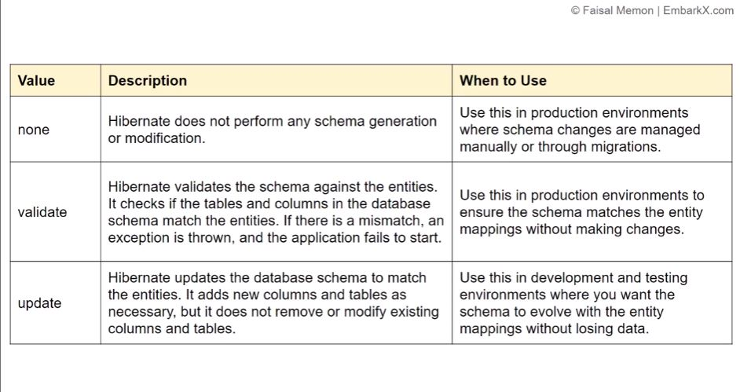
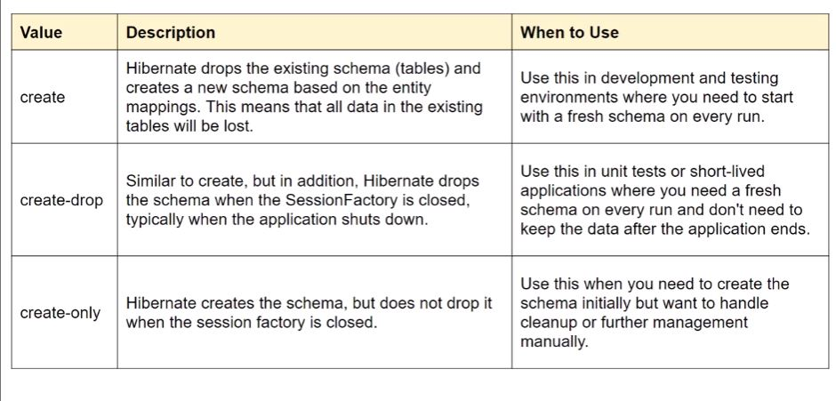

`spring.jpa.hibernate.ddl-auto=update` は、Spring Boot の `application.properties` に記述する JPA／Hibernate のデータベーススキーマ自動更新設定です。

## `ddl-auto` の主な設定値

| 設定値           | 意味                                |
| ------------- | --------------------------------- |
| `none`        | テーブル構造を自動変更しない                    |
| `validate`    | エンティティとテーブル構造の整合性を検証する。変更はしない     |
| `update`      | 既存のテーブル構造を可能な範囲で更新する              |
| `create`      | 起動時にテーブルを作り直す。既存のテーブル構造を破棄する場合がある |
| `create-drop` | 起動時にテーブルを作成し、アプリケーション終了時に削除する     |

